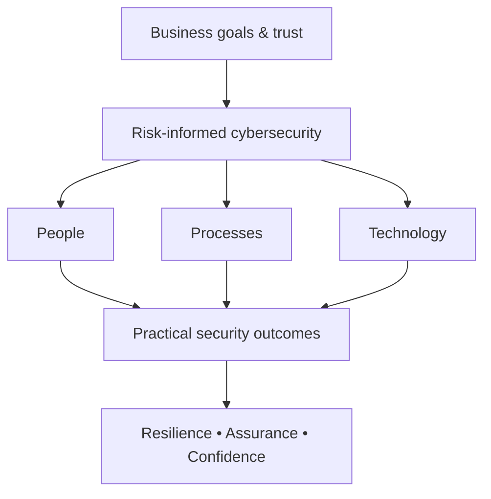

<div align="center">


### Cybersecurity Leader · GRC Strategist · Security Enabler

**Turning security complexity into business confidence.**

[](https://www.linkedin.com/in/vishalguptac/)
[](https://securitycube.com.au/)
[](#)


</div>

---

```text
┌─[vishal@security-cube]─[~/about]
└──╼ $ whoami
Cybersecurity leader | Global Head of Cybersecurity GRC
Builder of practical, risk-based security programmes
Curious about the intersection of people, process, technology & AI

┌─[vishal@security-cube]─[~/mission]
└──╼ $ cat purpose.txt
Enable the business. Strengthen trust. Make security usable.
```

## About Me

I am a Melbourne-based cybersecurity leader focused on making security an enabler of business outcomes—not just a compliance exercise. My experience spans **cybersecurity governance, enterprise risk, assurance, incident response, vulnerability management, security culture, and technical security operations**.

Currently serving as **Global Head of Cybersecurity GRC and CISO Delegate at Hansen Technologies**, I work across security strategy, frameworks, assurance and operational resilience. I enjoy connecting detailed technical evidence with clear, actionable decisions for leadership.

My approach is rooted in an idea that has guided my career: **security is most effective when people, processes and technology work together**.

## Areas of Focus

| Strategy & Governance | 🔎 Security Operations | 🤖 Automation & Innovation |
| :--- | :--- | :--- |
| Security strategy and roadmaps | Vulnerability management | AI-assisted risk workflows |
| ISO 27001 / NIST CSF 2.0 | Incident response & resilience | Power Platform automation |
| SOC 2 / ITGC assurance | Threat intelligence | Risk dashboards & analytics |
| Enterprise & third-party risk | Identity and access governance | Practical security education |
| Policy governance & culture | Security testing & remediation | Security Cube |

## Selected Impact

- **Assurance transformation:** Helped increase security compliance testing coverage from approximately **10% to 100%**.
- **Incident leadership:** Led coordination and recovery during a high-impact security incident while acting as interim CISO.
- **Process improvement:** Developed policy governance and reporting workflows with **SharePoint, Power Apps, Power Automate and Power BI**.
- **Risk-based security:** Built approaches connecting vulnerability exposure, threat intelligence, business criticality and remediation priorities.
- **Education & mentoring:** Taught cybersecurity concepts to **100+ learners** through bootcamp instruction and supported aspiring professionals.

> Selected examples are intentionally high-level and exclude confidential organisational details.

## What I'm Building

### [Security Cube](https://securitycube.com.au/)

Exploring a more interactive approach to **cybersecurity learning, governance and maturity assessment**—helping organisations understand their security posture through connected domains, functions, people, processes and technology.

**Ideas and prototypes I'm exploring:**

- **Cybersecurity maturity visualiser** — mapping capabilities to ISO 27001, NIST CSF and the Essential Eight.
- **AI-assisted vulnerability prioritisation** — bringing exploit intelligence and business context into remediation decisions.
- **Security GRC dashboards** — making complex risk and assurance data accessible to decision-makers.
- **Gamified cyber learning** — practical education for people and organisations with different levels of security maturity.

*Projects represent interests and work in progress; not all are publicly released products.*

## My Security Philosophy



## Frameworks, Platforms & Capabilities

<div align="center">


</div>

## Professional Journey

| Period | Role | Focus |
| --- | --- | --- |
| **2023–Present** | **Global Head of Cybersecurity GRC / CISO Delegate**, Hansen Technologies | Security governance, risk, assurance and resilience |
| **2022–2023** | **Security Operations Analyst & Penetration Test Coordinator**, Tabcorp / TLC Healthcare | Security operations, testing and compliance |
| **2022–2025** | **Cybersecurity Bootcamp Instructor**, Monash edX | Teaching and mentoring cybersecurity learners |

## Education & Community

- **Master's in Information Security**, RMIT University
- Cybersecurity educator, mentor and lifelong learner
- Interested in **psychology, behaviour, security culture and human-centred security**
- Happy to connect about **cybersecurity leadership, GRC transformation, security education and AI applications**

## GitHub Activity

<div align="center">


</div>

<sub>Stats are generated by third-party services and may occasionally be unavailable. Repository activity is only one part of my cybersecurity work.</sub>

---

<div align="center">

### 🤝 Let's Connect

**Security is a team sport. Let's make it practical, measurable and human-centred.**

[LinkedIn](https://www.linkedin.com/in/vishalguptac/) · [Security Cube](https://securitycube.com.au/) · [GitHub](https://github.com/GreyVish)


</div>
